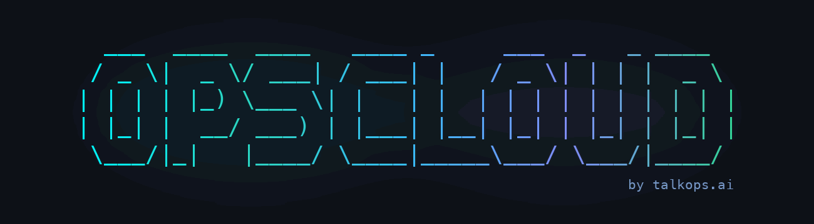

<div align="center">

<a href="https://github.com/talkops-ai/opscloud">
  
</a>

# OpsCloud

### Autonomous Terminal Multi-Agent Orchestrator for Cloud Operations & DevOps Coding

[](https://pypi.org/project/talkops-opscloud/)
[](https://www.python.org/)
[](https://langchain.com/)
[](https://docs.langchain.com/)
[](https://github.com/talkops-ai/opscloud)
[](https://modelcontextprotocol.io/)
[](https://textual.textualize.io/)
[](LICENSE)

[Quickstart](#quickstart) • [Architecture](#architecture-at-a-glance) • [Core Capabilities](#the-two-core-pillars) • [Governance & Safety](#approval-modes--governance) • [Jev System One](#jev-system-one-fast-classification--routing) • [CLI Reference](#cli-reference-summary) • [Documentation Hub](#documentation-hub)

</div>

---

## Overview

**OpsCloud** is an extensible, terminal-native multi-agent orchestrator engineered specifically for Platform Engineers, DevOps specialists, SREs, and Cloud Architects. It bridges the gap between hands-on infrastructure codebase development and autonomous multi-cloud operations with strict human-in-the-loop safety and zero context leakage.

```text
┌───────────────────────────────────────────────────────────────────────────────────────┐
│                                   OPSCLOUD TERMINAL                                   │
├───────────────────────────────────────────────────────────────────────────────────────┤
│  • Hands-on DevOps coding with dry-run validation (Terraform, K8s, Helm, CI/CD)       │
│  • Autonomous cloud operations across AWS, Azure, & GCP via dynamic subagent plugins  │
│  • <70ms prompt routing & <100ms smart mutating tool-call classification via Jev      │
│  • 17-stage LangGraph middleware pipeline with dual-level context compaction          │
│  • Isolated subagent memory sandboxing — zero terminal context pollution              │
└───────────────────────────────────────────────────────────────────────────────────────┘
```

---

## What Makes OpsCloud Different?

- **Dual-Engine Design**: Deep built-in platform engineering coding engine paired with an extensible plugin marketplace for autonomous cloud operations subagents.
- **Zero Blind Deployments**: Always authors reviewable code, computes plan diffs, and validates dry-runs (`terraform plan`, `kubectl diff`) before execution.
- **Sub-70ms Dynamic Routing**: Integrated **TypeSafe AI Jev System One** routes requests to optimal model tiers (Fast / Standard / Powerful) in milliseconds.
- **Context Isolation & Memory Sandboxing**: High-volume telemetry, thousands of raw log lines, and multi-file code searches remain sandboxed inside subagent branches; only clean, structured deliverables return to the operator.
- **Strict Human-In-The-Loop (HITL) Governance**: Instant toggling between **Manual**, **Auto**, and **Smart** approval modes with shell AST security scanning and metadata SSRF guards.
- **Closed-Loop CI/CD Rubric Verification**: Automated iterative grader loops that validate multi-step infrastructure tasks against strict acceptance criteria.

---

## The Two Core Pillars

```text
                     ┌────────────────────────────────────────┐
                     │          OPSCLOUD ORCHESTRATOR         │
                     └───────────────────┬────────────────────┘
                                         │
                 ┌───────────────────────┴───────────────────────┐
                 ▼                                               ▼
  ┌─────────────────────────────┐                 ┌─────────────────────────────┐
  │          PILLAR 1           │                 │          PILLAR 2           │
  │    Built-in Coding Engine   │                 │   Cloud Operations Plugins  │
  ├─────────────────────────────┤                 ├─────────────────────────────┤
  │ • Terraform / OpenTofu / CDK│                 │ • AWS SRE & Telemetry Agent │
  │ • Kubernetes Manifests/Helm │                 │ • AWS FinOps Cost Optimizer │
  │ • GitHub Actions / GitLab CI│                 │ • Cloud Security & IAM Audit│
  │ • ArgoCD & GitOps Workflows │                 │ • Database Tuning & Ops     │
  │ • OPA / Kyverno / Datadog   │                 │ • Azure & GCP Plugin Packs  │
  └─────────────────────────────┘                 └─────────────────────────────┘
```

### Pillar 1: Built-in Platform & DevOps Coding Engine (Main Agent)
- **Infrastructure as Code (IaC)**: Architect, refactor, and maintain production Terraform (HCL), OpenTofu, Terragrunt, AWS CDK (TypeScript/Python), CloudFormation, and Pulumi with provider version pinning, modular boundaries, and state locking.
- **Cloud-Native & Container Orchestration**: Author and patch Kubernetes manifests (Deployments, StatefulSets, Ingress, NetworkPolicies, CRDs), Helm charts, Kustomize overlays, and Dockerfiles with non-root security contexts and resource requests/limits.
- **CI/CD & GitOps Automation**: Generate and debug GitHub Actions, GitLab CI/CD, Tekton, and ArgoCD Application/ApplicationSet pipelines with pinned actions and secret masking.
- **Platform Tooling & Observability**: Author idempotent Bash scripts, Python platform utilities (boto3, click, typer), OPA/Rego policies, Prometheus alert rules, Datadog monitors, and Grafana dashboard models.

### Pillar 2: Cloud Operations via Plugin Marketplace
OpsCloud connects seamlessly to the **TalkOps DevOps Plugin Marketplace** ([`talkops-ai/devops-plugins`](https://github.com/talkops-ai/devops-plugins)) to dynamically discover and mount specialized subagents and skill packs:
- **`aws-finops-agent`**: Deep cloud spend audits, unattached storage discovery, idle NAT Gateway identification, and Compute Savings Plans analysis.
- **`aws-sre-agent`**: Distributed incident diagnosis, CloudWatch log filtering, X-Ray trace correlation, and actionable remediation runbooks.
- **`aws-cloud-security-engineer`**: IAM policy least-privilege analysis, Security Hub / GuardDuty triage, KMS configuration, and compliance posture validation.
- **`aws-platform-engineer`**: EKS cluster provisioning, VPC network topology design, AWS Load Balancer Controller configuration, and Karpenter autoscaling.
- **`aws-database-engineer`**: Aurora/RDS performance tuning, parameter group optimization, and DynamoDB scaling policies.

```bash
# Manage plugins from the CLI or interactive TUI
opscloud plugin marketplace add talkops-ai/devops-plugins
opscloud plugin install aws-sre-agent
opscloud plugin install aws-finops-agent
opscloud plugin list
```

---

## Quickstart

### 1. Installation

**Option A: Install via Shell Script (macOS & Linux)**
```bash
# Install latest release
curl -LsSf https://raw.githubusercontent.com/talkops-ai/opscloud/main/scripts/install.sh | bash

# Or install from local clone
./scripts/install.sh --local
```

**Option B: Install via PyPI (`pip`, `uv`, or `pipx`)**
```bash
# Using uv (recommended)
uv tool install talkops-opscloud

# Using pipx
pipx install talkops-opscloud

# Using standard pip
pip install talkops-opscloud
```

> [!NOTE]
> On Windows, run OpsCloud inside **[WSL (Windows Subsystem for Linux)](https://learn.microsoft.com/en-us/windows/wsl/install)** for full terminal, shell, and Textual TUI compatibility.

---

### 2. Launch & Authenticate

```bash
# Launch interactive TUI
opscloud
```

Inside the interactive session, configure your model providers with `/auth` or export environment variables:

```bash
# Anthropic Claude
export ANTHROPIC_API_KEY="sk-ant-..."

# OpenAI / OpenAI-Compatible
export OPENAI_API_KEY="sk-..."

# AWS Bedrock / Native IAM Session
export AWS_PROFILE="production"
export AWS_REGION="us-east-1"

# TypeSafe AI Jev Fast Router
export TYPESAFE_API_KEY="jev-..."
```

OpsCloud supports **22+ model providers** out of the box (Anthropic, OpenAI, AWS Bedrock, Google Gemini, Azure OpenAI, Ollama, DeepSeek, Groq, Mistral, Cohere, Together, XAI, and more).

---

### 3. Run Your First Tasks

**Interactive TUI Session:**
```text
Audit unattached EBS volumes and idle NAT Gateways across us-east-1 and ap-south-1, calculate monthly cost impact, and draft Terraform deletion diffs
```

**Non-Interactive / Headless Mode (`-p`):**
```bash
opscloud -p "Inspect Kubernetes deployment 'payment-service' in namespace 'prod', find why pods are in CrashLoopBackOff, and output a patched manifest"
```

---

## Architecture at a Glance

```text
┌─────────────────────────────────────────────────────────────────────────────────────────┐
│                                   OPSCLOUD ORCHESTRATOR                                │
├─────────────────────────────────────────────────────────────────────────────────────────┤
│  Input Prompt / Stdin ──> Unicode & Shell AST Scanner ──> Dynamic Approval Gate         │
│                                                                                         │
│  [Jev System One Router (<70ms)] ──> Selects Model Tier (Fast / Standard / Powerful)   │
│                                                                                         │
│  Ordered Middleware Pipeline (17+ Stages):                                              │
│    ConfigurableModel ──> JevRouter ──> CodeModelRetry ──> MCPContext ──> MemoryGuard    │
│    ──> PluginSkills ──> LocalContext ──> ShellAllowList ──> HITLApproval (Manual/Auto/  │
│    Smart) ──> ServerHooks ──> GoalCriteria ──> ContextCompaction ──> RubricEvaluator    │
│                                                                                         │
│  Delegation & Memory Isolation:                                                         │
│    ┌───────────────────┬───────────────────┬───────────────────┬───────────────────┐    │
│    ▼                   ▼                   ▼                   ▼                   ▼    │
│  [Project Agents]    [Plugin Agents]     [User Agents]      [Async Agents]   [Sandboxes]│
│  (.opscloud/agents) (devops-plugins)    (~/.opscloud/agents) (config.toml)  (Modal/Day) │
│    └───────────────────┴───────────────────┴───────────────────┴───────────────────┘    │
│                                           │                                             │
│                                           ▼                                             │
│                       SubagentMemoryStore (Context Sandboxed)                           │
└─────────────────────────────────────────────────────────────────────────────────────────┘
```

---

## Approval Modes & Governance

OpsCloud provides robust guardrails to protect production environments:

| Mode | Trigger / Flag | Safety Engine | Ideal Use Case |
|---|---|---|---|
| **Manual** *(default)* | Default | Human confirms every mutating command and tool execution | Production clusters, live AWS/GCP accounts |
| **Auto** | `-y`, `--auto-approve` | LLM reasoning evaluates action safety autonomously | Automated scripting, headless CI jobs (`-p`) |
| **Smart** | `--smart` | **TypeSafe AI Jev System One** (<100ms classifier) | Interactive workflows requiring fast zero-friction gating |

Toggle modes dynamically inside the TUI with **`Shift+Tab`**:
```text
Manual ──> Auto ──> Smart ──> Manual
```

### Defense-in-Depth Scanners
- **Shell AST Scanner**: Validates shell commands against allowlists (`-S recommended`, `-S all`, or custom CSV).
- **Unicode Security Scanner**: Detects Trojan Source attacks, bidirectional text overrides, and homoglyphs.
- **SSRF Guard**: Blocks unauthorized outbound calls to cloud instance metadata (`169.254.169.254`) and private RFC-1918 networks.
- **Headless MCP Security Tiers**: Categorizes tools into 4 tiers (`READ_ONLY`, `MUTATING_SAFE`, `MUTATING_DESTRUCTIVE`, `PRIVILEGED`).

---

## Jev System One: Fast Classification & Routing

OpsCloud integrates TypeSafe AI Jev System One for low-latency decision making:

1. **Smart Approval Gate (<100ms)**: Scores `mutating_probability`, `blast_radius`, and `risk_level` (0=Safe, 1=Controlled, 2=Critical) to emit instant interrupt decisions.
2. **Dynamic Model Router (<70ms)**: Classifies prompt complexity in <70ms and routes to the optimal model pool tier:
   - **Fast Tier** (Haiku / Flash / GPT-4o-mini): File reads, linting, git status, syntax checks.
   - **Standard Tier** (Sonnet / GPT-4o): Infrastructure coding, Kubernetes manifests, Terraform refactoring.
   - **Powerful Tier** (Claude 3.7 Thinking / o1 / DeepSeek R1): Multi-region architecture, root-cause incident forensics.
3. **Hybrid Rubric Grader**:
   - **Tier 1 (Fast-Pass)**: Evaluates acceptance criteria against evidence in parallel in <200ms.
   - **Tier 2 (Frontier LLM Fallback)**: Diagnoses failed criteria and supplies remediation guidance back to the worker agent.

---

## CI/CD Closed-Loop Rubric Verification

Automate quality and compliance gates in CI/CD pipelines with automated rubric grading loops:

```bash
opscloud -p "Create an AWS EKS Cluster Autoscaler Helm values configuration" \
  --rubric "1. AWS IAM role ARN referenced in serviceAccount annotations.
2. Balance-similar-node-groups flag is enabled.
3. Expander strategy set to least-waste.
4. Scale-down-utilization-threshold is configured.
5. Resource requests and limits explicitly defined." \
  --rubric-model "anthropic:claude-3-5-sonnet-latest" \
  --rubric-max-iterations 3 \
  --smart
```

```text
┌────────────────────────────────────────────────────────┐
│                   Rubric Evaluation Loop               │
├────────────────────────────────────────────────────────┤
│ 1. Worker Agent drafts code/manifests in workspace     │
│ 2. Grader evaluates work tree against rubric criteria  │
│ 3. If PASS ──> Exit 0, emit JSON verification report   │
│ 4. If FAIL ──> Grader feeds back remediation guidance  │
│ 5. Worker iterates on fixes and re-submits to Grader   │
│ 6. Repeats until PASS or max iterations reached        │
└────────────────────────────────────────────────────────┘
```

---

## Remote Cloud Sandboxes

Run heavy, untrusted, or resource-intensive tasks inside isolated cloud containers with `--sandbox`:

```bash
# Execute in an ephemeral cloud container
opscloud --sandbox modal "Compile and test the cross-platform platform binary"
```

Supported providers: **Modal**, **Daytona**, **LangSmith**, **AgentCore**, **Runloop**, **Vercel**, and **Docker**. Workspace files synchronize bi-directionally, automatically excluding local build caches (`.git`, `.venv`, `.terraform`, `node_modules`).

---

## Interactive TUI & Slash Commands

| Command | Action |
|---|---|
| `/auth` | Interactive credential manager for 22+ AI providers |
| `/model` | Switch the active model specifier (`provider:model`) |
| `/pool` | View or configure model tiers (Fast, Standard, Powerful) |
| `/plugin` | Browse marketplace, install, update, and manage subagent plugins |
| `/mcp` | Inspect connected Model Context Protocol servers & tools |
| `/skills` | Search and inspect active platform and domain skills |
| `/compact` | Compact conversation history to free context window |
| `/history` | View conversation session history and resume past threads |
| `/doctor` | Run diagnostic health checks on tools, credentials, and environment |
| `/clear` | Clear terminal conversation screen |

### Keybindings
- **`Shift+Tab`**: Cycle Approval Modes (`Manual` ➔ `Auto` ➔ `Smart`)
- **`Ctrl+O`**: Open message actions & context options
- **`Ctrl+C`**: Interrupt active generation or cancel task

---

## CLI Reference Summary

```bash
# Basic Interactive & Prompt Invocation
opscloud [OPTIONS] [PROMPT]

# Common Subcommands
opscloud auth list | set <provider> | remove <provider>
opscloud config show | list | get <key> | set <key> <value>
opscloud pool show | set <tier> <model> | reset
opscloud plugin list | install <id> | uninstall <id> | marketplace add <url>
opscloud skills list | info <name> | find <query>
opscloud mcp list | tools
opscloud threads list | delete <id>
opscloud doctor

# Core Flags
-p, --prompt TEXT                # Headless single-task execution prompt
-r, --resume [ID]                # Resume a previous conversation thread
-M, --model MODEL                # Primary model specifier (provider:model)
-a, --agent NAME                 # Launch with a specific dynamic subagent
-s, --skill NAME                 # Pre-load a specific skill
--approval-mode MODE             # Approval mode: manual, auto, or smart
-y, --auto-approve               # Enable classic classifier-backed Auto mode
--smart                          # Enable Jev-powered Smart approval mode (<100ms)
-S, --shell-allow-list LIST      # Shell allowlist (recommended, all, or custom CSV)
--effort LEVEL                   # Reasoning effort (off, low, medium, high)
--goal TEXT                      # Interactive goal with acceptance criteria
--rubric TEXT|@PATH              # Automated rubric grading loop
--rubric-model MODEL             # Grader model for rubric evaluation
--rubric-max-iterations N        # Max grading iterations
--sandbox [TYPE]                 # Ephemeral cloud sandbox provider
```

---

## Documentation Hub

Complete technical documentation is available in [`docs/opscloud-docs/`](docs/opscloud-docs/):

| Guide | Description |
|---|---|
| **[Overview](docs/opscloud-docs/overview.md)** | Core capabilities, dual-engine architecture, and environment configuration |
| **[Quickstart](docs/opscloud-docs/quickstart.md)** | Step-by-step setup, TUI controls, slash commands, and first steps |
| **[CLI Reference](docs/opscloud-docs/cli-reference.md)** | Complete CLI flags, subcommands, and non-interactive scripting options |
| **[Configuration](docs/opscloud-docs/Configuration.md)** | Configuration precedence, directory layouts, and runtime environment options |
| **[config.toml Reference](docs/opscloud-docs/config.toml.md)** | Full specification for model pools, UI, permissions, and compaction |
| **[Provider Credentials](docs/opscloud-docs/credentials.md)** | Credential setup for 22+ providers via `/auth` and environment variables |
| **[Approval Modes & Security](docs/opscloud-docs/approval-mode.md)** | Manual, Auto, Smart modes, Jev System One classifier, and AST scanners |
| **[Subagents](docs/opscloud-docs/subagents.md)** | Dynamic subagent discovery, isolated memory stores, and context compaction |
| **[Plugins & Marketplaces](docs/opscloud-docs/plugins.md)** | Community and private enterprise plugin architecture and discovery |
| **[Model Providers & Router](docs/opscloud-docs/model-providers.md)** | 22+ model providers, Jev dynamic routing (<70ms), and reasoning effort |
| **[Remote Sandboxes](docs/opscloud-docs/remote-sandboxes.md)** | Cloud sandbox execution with Modal, Daytona, LangSmith, and Docker |
| **[Goals & Rubrics](docs/opscloud-docs/goal-and-rubrics.md)** | Interactive goal tracking and automated CI/CD rubric grading loops |
| **[Lifecycle Hooks](docs/opscloud-docs/hooks.md)** | Deterministic pre/post-tool execution scripts via `hooks.json` |
| **[MCP Tools](docs/opscloud-docs/mcp-tools.md)** | Model Context Protocol setup, security tiers, and TUI inspector |
| **[Memory & Skills](docs/opscloud-docs/memory-and-skills.md)** | Workspace memory persistence, skill hierarchy, and convention learning |

---

## Contributing

Contributions are welcome! Please review our [Contributing Guidelines](CONTRIBUTING.md) and [Security Policy](SECURITY.md) before submitting a pull request.

```bash
git clone https://github.com/talkops-ai/opscloud.git
cd opscloud
uv venv && source .venv/bin/activate
uv pip install -e ".[dev,test-integration]"
uv run pytest tests/unit_tests/ -v
```

---

## License

OpsCloud is open-source software licensed under the [Apache License 2.0](LICENSE).
